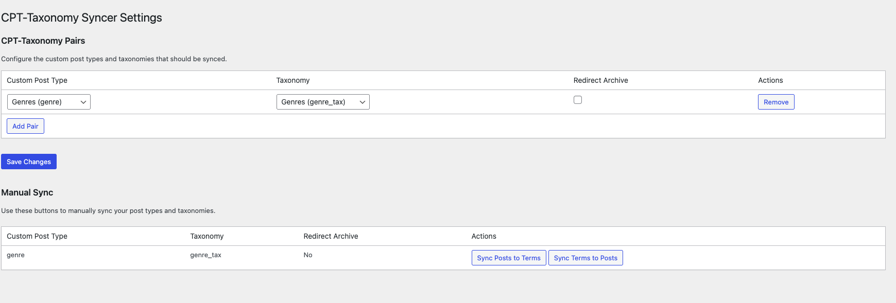
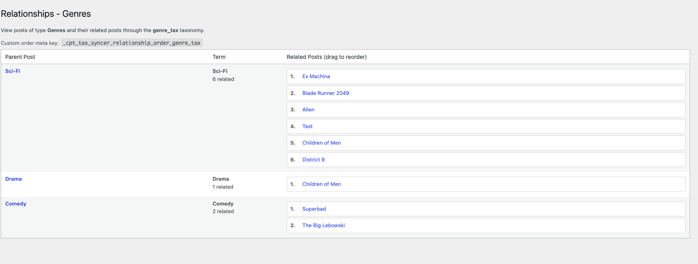

# CPT-Taxonomy Syncer

[](https://playground.wordpress.net/?blueprint-url=https://raw.githubusercontent.com/philhoyt/CPT-Taxonomy-Syncer/main/_playground/blueprint.json)

Keeps a custom post type and a taxonomy in sync, and adds Query Loop and navigation blocks that show related posts.



Pair a post type with a taxonomy and the plugin mirrors one onto the other. Publishing a post creates a term with the same name; creating a term creates a post with the same title. Renames and deletions flow both ways. Each side stores its partner's ID in meta (`_term_id_{taxonomy}` on the post, `_post_id_{post_type}` on the term), so the link does not depend on matching titles.

Because the taxonomy mirrors the post type, assigning its terms to other content gives you "related to this post" queries with nothing more than a normal tax query. The plugin builds on that with:

- A "Use synced relationship" toggle on the Query Loop block and a Relationship Query Loop variation. The block lists posts that share a term with the post being viewed.
- A Relationships screen under each synced post type's menu where related posts can be dragged into a custom order. The order is saved to `_cpt_tax_syncer_relationship_order_{taxonomy}` on the parent post.
- Previous Post (Relationship) and Next Post (Relationship) blocks that follow that order.
- A Synced Term column in the post list and a Linked Post box on the term edit screen.
- An optional 301 redirect from a term's archive to its linked post.
- Bulk sync for content that existed before the pair was added.
- A WP-CLI command that checks a pair and removes links to deleted partners.

## Requirements

- WordPress 6.0 or later
- PHP 7.4 or later
- Node.js 22 or later to build the JavaScript (the CI and release workflows use Node 24)

## Installation

1. Download `cpt-taxonomy-syncer.zip` from the [latest release](https://github.com/philhoyt/CPT-Taxonomy-Syncer/releases/latest).
2. In the WordPress admin, go to Plugins > Add New Plugin > Upload Plugin and choose the zip.
3. Click Install Now, then Activate.

Updates come from GitHub releases through Plugin Update Checker. The plugin is not on WordPress.org.

## Usage

### Add a pair

Go to Tools > CPT-Tax Syncer, click Add Pair, choose a post type and a taxonomy, and save. Tick Redirect Archive to send the taxonomy's archive URLs to the linked post. If the post type or taxonomy already has content, use the Sync Posts to Terms and Sync Terms to Posts buttons; they run in batches over the REST API.

Publishing a post in a synced post type creates its term. Drafts, pending and private posts get no term, so their titles never appear in the (public) taxonomy; the `cpt_tax_syncer_synced_post_statuses` filter widens the list. Posts created from terms are published immediately with the term description as their initial content. Editing a term afterwards renames its post but leaves the post content alone unless the `cpt_tax_syncer_sync_term_description` filter returns true.

Deleting a post permanently deletes its term. Deleting a term moves its post to the trash (or deletes it when the trash is disabled); trashing a post leaves its term in place until the trash is emptied.

Note that whoever can create, rename or delete a term in the paired taxonomy thereby creates, renames or trashes a post in the paired post type, whatever their post capabilities. With the default taxonomy capabilities that is Editors and above; if you grant taxonomy capabilities to lower roles, use the `cpt_tax_syncer_before_sync_term_to_post` and `cpt_tax_syncer_before_sync_term_deletion_to_post` filters to add a post capability check.

### Query Loop

Add a Query Loop block (or the Relationship Query Loop variation) to a single post template. In the inspector, open Synced Relationships and turn on "Use synced relationship". Turn on "Use custom order" to sort by the order saved on the Relationships screen; otherwise related posts sort by `menu_order`, then ID.

### Custom order

Each synced post type gets a Relationships item in its admin menu. The screen lists every parent post with its related posts. Drag to reorder; the order saves on drop.



### Previous and Next blocks

Add Previous Post (Relationship) or Next Post (Relationship) to a single post template. Block options: which pair to follow, whether to use the custom order (on by default), and the link text (defaults "Previous:" and "Next:").

### Duplicate titles

If a second post has the same title as an existing term, its term gets a suffix: the post slug when it differs from the title, otherwise the post ID (`Comedy (ID: 123)`).

### Removing a pair and uninstalling

Removing a pair stops syncing but leaves posts, terms, and meta in place. Uninstall deletes the saved pairs and also leaves the relationship meta, so reinstalling picks the links back up. There is no built-in way to strip the meta.

## REST API

All routes are under `cpt-tax-syncer/v1`. The create routes require the post type's `publish_posts` or the taxonomy's `manage_terms` capability and only accept a configured pair; the sync, batch and `/relationships` routes require `manage_options`; the Relationships screen routes require the post type's edit capability.

| Route | Purpose |
|-------|---------|
| `/create-term`, `/create-post` | Create one side of a link for a given post or term |
| `/sync-posts-to-terms`, `/sync-terms-to-posts` | Single-request bulk sync |
| `/batch-sync/init`, `/batch-sync/process`, `/batch-sync/progress`, `/batch-sync/cleanup` | Batched bulk sync used by the settings page |
| `/relationships` | Every linked post and term across all configured pairs (administrators only) |
| `/post-type-relationships` | One page of parent posts and their related posts for a post type (Relationships screen); related posts the caller cannot read are omitted |
| `/relationship-order` | Save the custom order for a parent post |

## Hooks

| Hook | Type | Purpose |
|------|------|---------|
| `cpt_tax_syncer_before_sync_post_to_term` | filter | Return `false` to skip creating a term for a post. Receives `$post_id`, `$post`, `$cpt_slug`, `$taxonomy_slug`. |
| `cpt_tax_syncer_after_sync_post_to_term` | action | Runs after a term is created for a post. |
| `cpt_tax_syncer_before_sync_term_to_post` | filter | Return `false` to skip creating a post for a term. |
| `cpt_tax_syncer_after_sync_term_to_post` | action | Runs after a post is created for a term. |
| `cpt_tax_syncer_before_sync_post_deletion_to_term` | filter | Return `false` to keep the term when its post is deleted. Receives `$post_id`, `$term`, `$cpt_slug`, `$taxonomy_slug`. |
| `cpt_tax_syncer_after_sync_post_deletion_to_term` | action | Runs after a post deletion removed its term. |
| `cpt_tax_syncer_before_sync_term_deletion_to_post` | filter | Return `false` to keep the post when its term is deleted. Receives `$term_id`, `$post_id`, `$cpt_slug`, `$taxonomy_slug`. |
| `cpt_tax_syncer_after_sync_term_deletion_to_post` | action | Runs after a term deletion trashed or deleted its post. |
| `cpt_tax_syncer_linked` | action | Runs whenever a post and a term are linked on both sides. Receives `$post_id`, `$term_id`, `$cpt_slug`, `$taxonomy_slug`. |
| `cpt_tax_syncer_synced_post_statuses` | filter | Post statuses that create a term. Default `array( 'publish' )`. |
| `cpt_tax_syncer_sync_term_description` | filter | Return `true` to copy the term description into the post content on term edits. Default `false`. |
| `cpt_tax_syncer_sync_error` | action | Runs when a sync write fails. Receives the `WP_Error`, `$post_id`, `$term`. |
| `cpt_tax_syncer_query_vars` | filter | Change the `WP_Query` args used for relationship queries. Receives `$query_vars`, `$syncer_settings`, `$current_pair`, `$post`. |
| `cpt_tax_syncer_relationship_order` | filter | Change the array of post IDs before a custom order is saved. Receives `$order`, `$parent_post_id`, `$taxonomy`. |
| `cpt_tax_syncer_max_posts_per_query` | filter | Cap on posts returned by a relationship query. Default 1000. |
| `cpt_tax_syncer_batch_size` | filter | Posts or terms per batch during bulk sync. Default 100. |
| `cpt_tax_syncer_cache_ttl` | filter | Lifetime of the relationship query transients. Default 15 minutes. |

## WP-CLI

```bash
wp cpt-tax-syncer verify <cpt_slug> <taxonomy_slug> [--fix]
```

Counts posts without a term link, terms without a post link, and links that point at a deleted partner. `--fix` removes the dangling links; it does not create missing terms or posts. Use the bulk sync buttons for that.

The other commands are for test sites:

```bash
wp cpt-tax-syncer generate-test-data <cpt_slug> <taxonomy_slug> [--count=<n>] [--skip-sync] [--create-terms]
wp cpt-tax-syncer test-sync <cpt_slug> <taxonomy_slug> <posts-to-terms|terms-to-posts> [--batch-size=<n>] [--verbose]
wp cpt-tax-syncer cleanup <cpt_slug> <taxonomy_slug> [--confirm]
```

`cleanup` permanently deletes every post in the post type and every term in the taxonomy. It asks for confirmation unless `--confirm` is passed. Do not run it on a live site.

## Development

```bash
npm install
composer install
npm start            # watch and rebuild src/ into build/
npm run build        # production build
npm run lint:js
npm run lint:css
npm run lint:dup     # jscpd duplication check
npm run format
composer run lint    # phpcs (WordPress standards, PHPCompatibility, readability metrics)
composer run lint-fix
composer run mess    # phpmd
npm run env:start    # wp-env site on http://localhost:8888 with the plugin active
npm run test:php     # PHPUnit inside the wp-env tests container
npm run plugin-zip   # build the distributable zip (respects .distignore)
```

`composer install` also copies Plugin Update Checker from `vendor/` into `lib/`, which ships in the zip. The PHPUnit suite under `tests/phpunit/` covers the sync hooks, bulk sync, REST routes, settings sanitizer, Query Loop integration and the adjacent-post lookup; `TESTING.md` lists the WP-CLI checks for larger datasets.

CI (`.github/workflows/ci.yml`) runs phpcs and phpmd on every supported PHP version, the JS and CSS linters, jscpd, the build, and the PHPUnit suite on every push and pull request to `main`.

## Releases

Bump the version in `cpt-taxonomy-syncer.php` (header and `CPT_TAXONOMY_SYNCER_VERSION`), `package.json`, both `block.json` files, and `Stable tag` in `readme.txt`, add the changelog entry to `readme.txt`, then push a `v`-prefixed tag:

```bash
git tag v1.4.4 && git push origin v1.4.4
```

The release workflow builds the assets, runs `npm run plugin-zip`, extracts that version's section from the `readme.txt` changelog as the release notes, and attaches `cpt-taxonomy-syncer.zip` and `readme.txt` to the GitHub release. Plugin Update Checker reads that release to offer the update.

## Limitations

- Posts created from terms are always published; there is no option to create them as drafts.
- Relationship queries are capped at 1000 posts unless `cpt_tax_syncer_max_posts_per_query` raises it.
- Uninstall leaves relationship meta behind by design.

## License

GPL-2.0-or-later
